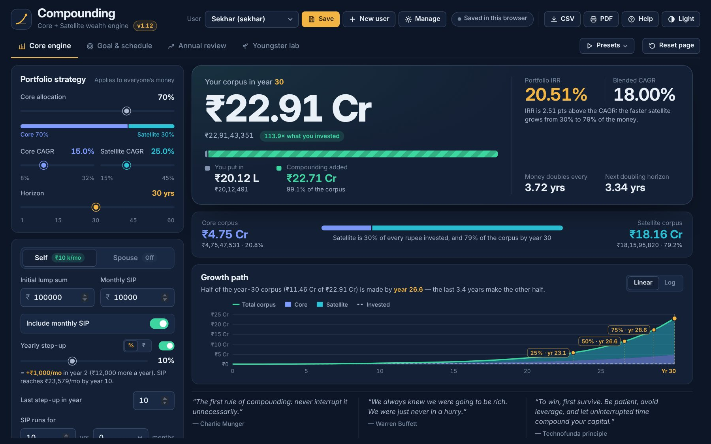

# Compounding Calculator

**Core + Satellite wealth engine · v1.12 · Developed by Sathiya Sekhar E**

A planning tool for long-term equity investors. It shows how a portfolio split into a steady **core** and a faster-growing **satellite** compounds over time, how much of the final money comes from compounding rather than from what you put in, and what it takes to reach a goal.

**▶ Open the calculator: https://esathiyasekhar.github.io/CompoundingCalc/**

No sign-in, no install, no server. Everything runs in your browser.



---

## What it does

| Page | The question it answers |
|---|---|
| **Core engine** | If I invest this lump sum and this monthly SIP, split this way, what will I have in *n* years? |
| **Goal & schedule** | When does my plan reach my goal? What SIP, or what return, gets there on time? What does every year look like? |
| **Annual review** | I have real results for the years so far. Am I still on track, and what must change from here? |
| **Youngster lab** | What is starting early worth? Wealth at any three ages from a lump sum, a SIP or both, and the cost of waiting. |

### Features

- **Two pots, no rebalancing.** Core and satellite each compound at their own CAGR, so the satellite's share of the wealth grows over time.
- **Portfolio IRR beside Blended CAGR.** The IRR is calculated on the actual cash-flow timing.
- **SIP settings.** Yearly step-up in **%** or **₹**, with an on/off switch and a last step-up year. The SIP can stop after any number of years and months.
- **Spouse investments.** Optional, with a self-only vs combined comparison.
- **Growth chart.** Linear or log scale, with markers where 25%, 50% and 75% of the final corpus has been made.
- **Goal solver.** The year the goal is reached, the SIP needed on time, and the CAGR needed with today's SIP, plus a table of what different CAGRs do.
- **Doubling ladder and schedule.** A doubling ladder and a 60-year year-by-year schedule, with CSV download and copy.
- **Users with IDs and goals.** Each user's year-end records feed a revised projection and a course correction.
- **Youngster lab.** Wealth at any three ages (up to 100) from a lump sum, a monthly SIP or both, and the cost of waiting 3, 5 or 10 years at a time.
- **Presets for talks.** 19 ready-made demonstrations in four groups (10× in 10 years, Youngster lab, the family math, more from the slides). One click sets the inputs and opens the page, with a presenter note and Previous / Next.
- **Built-in Help.** Press **Help** or **F1** to open the user manual at the page you are on. The design manual is also included.
- **Look and Reset.** Dark and light themes, a one-page or full PDF report, and **Reset page** with Undo on every page.

---

## Quick start

1. Open the calculator link above.
2. On **Core engine**, enter a lump sum and monthly SIP, then set **Core allocation**, **Core CAGR** and **Satellite CAGR**.
3. Read your corpus at the horizon. Hover over the chart to see any year.
4. Press **New user** to save a plan with your name, a user ID and a goal.
5. Open **Goal & schedule** to see when you reach the goal and the SIP that gets there on time.

The standard plan is ₹1,00,000 lump sum, ₹10,000 a month with a 10% step-up for 10 years, 70% core at 15% and 30% satellite at 25%. Over 30 years it grows to about **₹22.91 Cr** from **₹20.12 L** invested, a Portfolio IRR of **20.51%** against a Blended CAGR of **18.00%**.

---

## Manuals

| Manual | Online | PDF |
|---|---|---|
| User manual: every page and control, a worked example, FAQ, glossary | [user-manual.html](manual/user-manual.html) | [PDF](manual/Compounding-Calculator-User-Manual.pdf) |
| Design manual: architecture, formulas, solvers, data model, visual system, build, testing | [design-manual.html](manual/design-manual.html) | [PDF](manual/Compounding-Calculator-Design-Manual.pdf) |

---

## Your data

- Users and year-end records are saved **only in your own browser** on your own device. Nothing is sent anywhere, and other visitors never see your data.
- In Chrome or Edge you can also link a **database file** (Manage → Database file). Save it locally or in OneDrive to use the same users on another PC.
- Use **Manage → Export all users (JSON)** to keep a backup. Clearing browser data removes users that were not exported or saved to a database file.

---

## Windows app

A per-user Windows installer (`CompoundingCalculator-Setup.exe`, no administrator rights needed) installs the same calculator as a desktop app. It opens in its own Edge or Chrome window, with Start menu and desktop shortcuts and an entry in *Installed apps* for uninstalling.

---

## Run it yourself

The calculator is plain HTML, CSS and JavaScript with no build step.

- **On your PC:** open `index.html` in Chrome or Edge.
- **Or from a local web server:**
  ```bash
  python -m http.server 8000
  # then open http://localhost:8000
  ```

### Files

```
index.html          page markup: header, four pages, dialogs
styles.css          design tokens (dark and light), components, print styles
calculator.js       the calculation engine (no page access; also usable from Node)
app.js              interface, charts, users, storage, Help
manual/             user and design manuals (HTML + PDF) and screenshots
test_runner.html    engine test suites; should end with "ALL 8 TEST SUITES PASSED"
test_milestones.html  Youngster lab checkpoints at 50, 60 and 70
```

---

## Publishing an update on GitHub Pages

1. Replace **all** the files together, including the whole `manual/` folder (with `img/`). `index.html` stays at the top level.
2. If the version changed, update the version stamps so browsers fetch the new files instead of old saved copies:
   - `APP_INFO` (version, date, history) in `app.js`
   - the `app-version` meta tag and the `?v=` on `styles.css`, `calculator.js` and `app.js` in `index.html`
   - the `?v=` on `manual.css`, `manual.js` and the images in both manuals
3. Commit to `main`. **Settings → Pages** deploys it in a minute or two.

The full release checklist is in the Design manual, chapter 8.

---

## How the numbers are worked out (short version)

- **Each year:** each pot grows by `opening × CAGR`, plus SIPs that earn about half a year's return in the year they go in. For a part-year of *m* months, they earn (1 − m/24) of a year's return.
- **Step-up:** `monthly SIP in year y = base × (1 + step)^(min(y, last step-up year) − 1)`, or `base + ₹ × steps` in ₹ mode.
- **Blended CAGR:** `core share × core CAGR + satellite share × satellite CAGR`.
- **Portfolio IRR:** the rate that makes the net present value of all cash flows, at their real dates, equal to zero.
- **Goal SIP and required CAGR:** solved by bisection over the full schedule, keeping your core–satellite gap. Every answer is checked by putting it back into the schedule.

All formulas are in the Design manual, chapters 3 to 5.

---

## Disclaimer

Projections, not promises. Every result assumes the same return every year, and real markets are uneven. Use the Annual review each year to replace assumptions with what actually happened. This tool is for education and planning and is not investment advice.

---

Compounding Calculator v1.12 · 29 Oct 2026 · Developed by **Sathiya Sekhar E**
